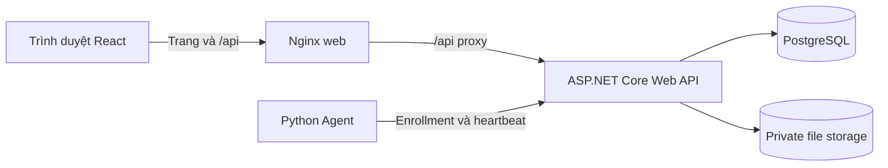

# IT Management
Ứng dụng đồ án quản lý tài sản CNTT (ITAM) và hỗ trợ dịch vụ CNTT (ITSM), định hướng một hệ thống nội bộ có thể dựng lại và trình diễn: React SPA, ASP.NET Core Web API, PostgreSQL, kho file riêng tư và Python endpoint Agent.

Tài liệu này hướng dẫn cài đặt, khởi chạy, sử dụng theo vai trò và kiểm thử. Tính năng đang có và phần còn nằm trong roadmap được phân biệt rõ để dữ liệu xem trước không bị hiểu nhầm là nghiệp vụ đã kết nối.

## Mục tiêu và phạm vi

- Quản lý người dùng nội bộ, tài sản và vòng đời cấp phát/trả tài sản.
- Đăng ký, theo dõi và thu hồi Agent; tách trạng thái kết nối, chính sách Agent và trạng thái tài sản.
- Cung cấp trang theo vai trò Admin, Employee và Technician.
- Phát triển tiếp luồng hỗ trợ ticket và file portal theo roadmap.

Dự án không hướng tới đăng nhập hệ điều hành, remote shell/remote command, domain controller, VM management hay nền tảng ITSM quy mô lớn. Inventory của Agent chỉ thu thập trong phạm vi đã đồng ý; dữ liệu người dùng thuộc tài khoản, không thuộc Agent.

## Kiến trúc



- `frontend/admin/`: React 19, TypeScript, Vite và Ant Design; SPA phục vụ cả ba vai trò.
- `backend/`: .NET 10 Web API theo các lớp API, Application, Domain và Infrastructure; Entity Framework Core, ASP.NET Identity và PostgreSQL.
- `agent/`: Python Agent với chế độ `real` và `simulated`.

Khi chạy Compose, Nginx phục vụ web và chuyển tiếp `/api` tới API. API cũng được publish riêng để phục vụ Agent và kiểm thử.

## Trạng thái hiện tại

**Đã kết nối API thật**

- Đăng nhập và phân quyền theo vai trò; Admin quản lý Employee/Technician tại `/admin/users`. Khóa tài khoản hoặc đổi vai trò làm JWT cũ mất hiệu lực. Tài khoản Admin bootstrap không thể bị sửa/khóa qua màn quản lý thông thường.
- Quản lý tài sản tại `/admin/assets`: tạo, xem chi tiết, tìm kiếm/phân trang, cập nhật thông tin và vòng đời.
- Cấp phát/trả/thu hồi tài sản và xem lịch sử; Employee xem tài sản đang được cấp tại `/employee`.
- Quản lý Agent tại `/admin/agents`: enrollment token dùng một lần, heartbeat, disable, phục hồi/re-enrollment và hiển thị riêng connectivity/policy/trạng thái tài sản.
- API file riêng tư cho Employee: upload, liệt kê, tải xuống và xóa theo chủ sở hữu. Upload khóa quota bằng transaction; giao diện file chưa có.
- Employee và Technician có trang portal theo vai trò; phạm vi portal hiện tại còn giới hạn.

**Còn là bản xem trước hoặc chưa hoàn thiện**

- Dashboard tại `/admin` hiển thị số liệu minh họa.
- Ticket tại `/admin/tickets` là dữ liệu xem trước phía trình duyệt; chưa có workflow ticket persist qua API. Không dùng dữ liệu này làm báo cáo nghiệp vụ.
- Quản trị quota, đối soát/recovery storage và file portal chưa triển khai.
- Dashboard thật, quy trình ticket ba vai trò, hardening triển khai, backup/restore và nghiệm thu end-to-end là các phần roadmap.

Các bản ghi tạo trong những màn preview chỉ giữ trong state của trang, có thể mất khi tải lại. Không dùng Dashboard hoặc Ticket preview cho báo cáo nghiệp vụ.

## Yêu cầu môi trường

- Windows 10/11 với PowerShell, hoặc môi trường tương đương có Docker Compose.
- Docker Desktop để chạy nhanh toàn bộ ứng dụng hoặc PostgreSQL kiểm thử.
- .NET 10 SDK cho backend và integration tests.
- Node.js/npm cho frontend.
- Python 3.11 trở lên cho Agent và kiểm thử Agent.

## Khởi chạy nhanh bằng Docker Compose

Đây là cách đơn giản nhất để chạy demo toàn bộ stack. Từ thư mục gốc repository:

```powershell
docker compose -f backend/docker-compose.yml up --build
```

Đợi PostgreSQL healthy và API khởi động, sau đó mở:

| Dịch vụ | URL |
| --- | --- |
| Web | http://localhost:8088 |
| API | http://localhost:8080 |
| Swagger | Chỉ bật khi API chạy với môi trường `Development`; Compose chạy `Production` |

API tự áp dụng migration và seed các role/tài khoản Admin ban đầu. Đăng nhập demo:

- Tên đăng nhập: `admin`
- Email: `admin@itmanagement.local`
- Mật khẩu: `Admin@12345`

Đổi thông tin demo trước khi dùng chung. Compose hiện có mật khẩu PostgreSQL mặc định và JWT fallback; chỉ dùng trên máy local đáng tin cậy, không expose các cổng ra Internet. Đặt `JWT_SECRET` mạnh không thay thế việc đổi credential PostgreSQL và rà soát toàn bộ cấu hình triển khai. Đây chưa phải cấu hình production.

Compose lưu PostgreSQL và file trong named volumes. Dừng stack nhưng giữ dữ liệu:

```powershell
docker compose -f backend/docker-compose.yml down
```

Chỉ dùng `down -v` khi chủ ý xóa dữ liệu database và file trong volumes. Không dùng thao tác đó để dọn môi trường có dữ liệu cần giữ.

## Chạy frontend và API riêng

Cách này hữu ích khi phát triển UI. Ví dụ dưới đây dùng PostgreSQL từ Compose, API chạy Development trên cổng `5038`, Vite proxy `/api` tới cổng đó. Mở các terminal riêng và chạy từ thư mục gốc.

1. Khởi chạy PostgreSQL:

```powershell
docker compose -f backend/docker-compose.yml up -d postgres
```

2. Chạy API:

```powershell
$env:ASPNETCORE_ENVIRONMENT = 'Development'
$env:ConnectionStrings__DefaultConnection = 'Host=localhost;Port=5432;Database=itmanagement;Username=postgres;Password=postgres'
dotnet run --project .\backend\src\ITManagement.API --urls http://localhost:5038
```

Swagger Development: http://localhost:5038/swagger. Không dùng credential/cấu hình mẫu này trên mạng công cộng.

3. Cài và chạy frontend:

```powershell
npm ci --prefix frontend/admin
npm --prefix frontend/admin run dev
```

Mở URL Vite được in ra terminal, thường là http://localhost:5173. Vite mặc định proxy `/api` tới `http://localhost:5038`; nếu đổi cổng API, cập nhật `API_PROXY_TARGET` trong file env của Vite theo cấu hình dự án.

Khi chạy API ngoài Compose, hãy cấu hình connection string, JWT secret, CORS và `FileStorage:RootPath` phù hợp trong `appsettings*.json` hoặc environment variables. Không để private file storage nằm trong thư mục static/public của web server.

## Hướng dẫn sử dụng

### Admin

1. Đăng nhập bằng tài khoản Admin.
2. Vào **Tài khoản** để tạo/cập nhật Employee hoặc Technician, khóa/mở tài khoản và quản lý vai trò.
3. Vào **Tài sản** để tạo tài sản, xem chi tiết, tìm kiếm và quản lý vòng đời.
4. Trong chi tiết tài sản, dùng **Cấp phát / lịch sử** để cấp cho Employee đang hoạt động, xem lịch sử, trả hoặc thu hồi. Mỗi lần cấp lại tạo bản ghi lịch sử mới. Không chuyển thẳng tài sản sang `Assigned`; trạng thái cấp phát được quản lý qua workflow assignment. `Retired` là trạng thái cuối.
5. Vào **Agent** để đăng ký Agent cho tài sản, theo dõi heartbeat, disable hoặc phục hồi Agent. Enrollment token chỉ hiển thị một lần và có hạn; chuyển token cho Agent qua lời nhắc bảo mật, không ghi vào source control.
6. Dashboard và Ticket hiện vẫn là preview, không dùng để vận hành thật.

### Employee và Technician

- Employee đăng nhập tại `/employee` để xem hồ sơ và tài sản đang được cấp cho chính mình. API xác định chủ sở hữu từ JWT, không tin `userId` do client tự gửi.
- Technician đăng nhập tại `/technician`. Giao diện portal đã có nhưng workflow ticket đầy đủ chưa triển khai.
- Route được giới hạn theo vai trò ở frontend và API; không chia sẻ phiên đăng nhập hoặc credential giữa các tài khoản.

### Python Agent

1. Đảm bảo API/PostgreSQL đang chạy và tài sản đã được tạo.
2. Admin mở **Agent**, chọn tài sản/chế độ và tạo enrollment token.
3. Cài dependencies, enrollment, rồi chạy Agent bằng file state riêng cho mỗi instance.

Hướng dẫn lệnh đầy đủ cho `real`/`simulated`, consent, heartbeat, recovery, state/credential và live smoke nằm trong [agent/README.md](agent/README.md). Chế độ `real` chỉ gửi hostname, OS, CPU, tổng RAM và phiên bản Agent khi có `--consent-inventory`. Chế độ `simulated` dùng fixture và được server đánh dấu theo token. Hai Agent trên cùng máy không đại diện cho hai thiết bị vật lý. Không commit state hoặc credential.

## API chính

API trả response theo envelope `success/message/data/errors`. Swagger/OpenAPI chỉ bật ở Development. Các API quản trị yêu cầu Admin; API cá nhân lấy owner từ danh tính xác thực.

| Nhóm | Endpoint tiêu biểu | Mục đích |
| --- | --- | --- |
| Tài khoản | `GET/POST /api/users`, `PUT /api/users/{id}` | Admin quản lý Employee/Technician |
| Tài sản | `GET/POST /api/assets`, `GET /api/assets/search`, `GET/PUT /api/assets/{id}` | Tra cứu và quản lý tài sản; `GET /api/assets` còn phục vụ lookup tương thích Agent |
| Cấp phát | `POST /api/assets/{id}/assign`, `POST /api/assets/{id}/return`, `POST /api/assets/{id}/revoke`, `GET /api/assets/{id}/assignments` | Admin cấp, trả/thu hồi và xem lịch sử |
| Tài sản của tôi | `GET /api/me/assets` | Employee xem tài sản theo JWT |
| Agent | `POST /api/agents/enrollment-tokens`, `POST /api/agents/enroll`, `POST /api/agents/heartbeat`, `GET /api/agents` | Enrollment, telemetry và quản trị Agent |
| File riêng tư | `POST/GET /api/files`, `GET /api/files/{id}/download`, `DELETE /api/files/{id}` | Employee upload/liệt kê/tải/xóa file thuộc tài khoản |

Contract Agent, payload và recovery được mô tả chi tiết trong [agent/README.md](agent/README.md). Các endpoint quản trị Agent yêu cầu Admin; Agent dùng credential riêng, không dùng JWT người dùng.

## Kiểm thử

### Cài dependencies

```powershell
npm ci --prefix frontend/admin
python -m venv agent/.venv
agent\.venv\Scripts\python.exe -m pip install -r agent/requirements-dev.txt
```

Backend integration tests cần PostgreSQL riêng trên `127.0.0.1:55432`. Không trỏ biến `TEST_POSTGRES` vào database nghiệp vụ. Có thể tạo PostgreSQL test tạm bằng Docker:

```powershell
docker run --rm -d --name itam-test-postgres -e POSTGRES_PASSWORD=postgres -p 127.0.0.1:55432:5432 postgres:16-alpine
```

Chạy các kiểm thử từ thư mục gốc repository:

```powershell
$env:TEST_POSTGRES = 'Host=127.0.0.1;Port=55432;Username=postgres;Password=postgres'
dotnet test .\backend\ITManagement.slnx
agent\.venv\Scripts\python.exe -m pytest .\agent\tests -q
npm --prefix frontend/admin test
npm --prefix frontend/admin run build
```

Dừng PostgreSQL test sau khi hoàn tất:

```powershell
docker stop itam-test-postgres
```

Smoke tests trình duyệt cho Agent, tài khoản, tài sản và cấp phát nằm trong `frontend/admin/tests/`; deployment smoke chạy bằng `npm --prefix frontend/admin run test:deployment`. Các smoke UI cần API/Vite test riêng, Playwright/Edge và biến môi trường test. Xem [agent/README.md](agent/README.md) để biết cách chạy live Agent/UI smoke và thiết lập test database chi tiết. Smoke tạo dữ liệu thật, chỉ chạy trên môi trường dùng thử.

## Lưu trữ và vận hành dữ liệu

- PostgreSQL và private file storage được lưu ở Docker named volumes khi chạy Compose.
- API file có upload/list/download/delete theo owner; upload tối đa 10 MiB/file, multipart field `file`, request tối đa 11 MiB. API trả 201 với metadata; không trả storage key. Dung lượng được tính bằng byte stream thực tế, khóa cùng hàng quota với thao tác xóa. Delete cập nhật metadata/quota logic trong transaction, sau đó dọn blob; nếu filesystem lỗi, gọi lại DELETE cùng ID để retry cleanup.
- Khi mất phản hồi commit, blob được giữ để tránh xóa nhầm dữ liệu đã commit. Cleanup thất bại hoặc tiến trình bị ngắt có thể để lại orphan; đối soát/recovery thuộc P07B và chưa triển khai. Không tự retry upload nếu chưa kiểm tra danh sách file.
- File không được phục vụ như static asset. Không mount private volume vào Nginx hoặc chia sẻ trực tiếp đường dẫn trên đĩa.
- Sao lưu cần bao gồm cả PostgreSQL lẫn private file storage và phải kiểm tra quy trình restore; chưa có quy trình backup/restore production được xác nhận.
- Khi nâng phiên bản, không tự xóa volume hoặc chạy migration trên dữ liệu quan trọng nếu chưa có backup và kế hoạch rollback.

## Tài liệu

- [Python Agent: cài đặt, vận hành và kiểm thử](agent/README.md)

Trạng thái tính năng trong README được đối chiếu với repository ngày 31/10/2026. Các tính năng chưa kết nối API được ghi rõ là preview hoặc chưa triển khai.
